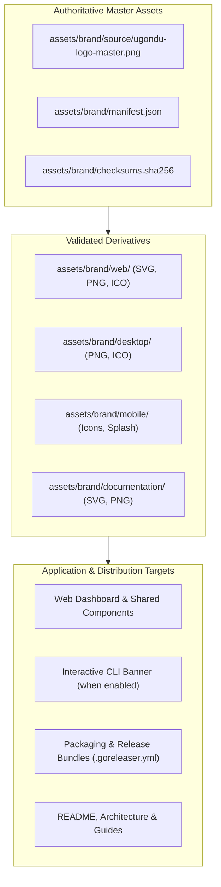

# Ugondu Brand Asset Architecture & Universal Lifecycle

> [!NOTE]
> **Module**: System Architecture — Brand Assets & Distribution  
> **Authority**: Ujomor Systems Engineering & Governance Authority  
> **Organization**: Air Roofers SASU  
> **Status**: RATIFIED & FROZEN

---

## 1. Architectural Philosophy

Brand identity in the Ugondu platform is a **controlled product asset**, not an unmanaged collection of independent images scattered across directories.

The core execution engine, microservices, and thin-client binaries maintain zero hard runtime dependencies on graphical assets. The platform operates headlessly and deterministically without requiring a display server or graphical resources, while web interfaces, desktop packaging, documentation, and interactive terminal sessions source their visual assets from a single authoritative root: `assets/brand/`.

---

## 2. Integrity & Validation Engine

All brand assets are validated continuously via automated CI gates:
1. **Manifest Completeness**: Every declared asset in `manifest.json` must exist on disk.
2. **Cryptographic Checksum Verification**: Every file must match its entry in `checksums.sha256`.
3. **Decodability & Alpha Inspection**: Every PNG must decode cleanly with genuine alpha transparency (alpha min = 0).
4. **SVG Sanitization**: Vector graphics must contain valid XML, zero unsafe scripts, and exact brand colors (`#02438d`, `#f5ae04`).
5. **CLI Separation**: Machine-readable output formats (`--format json`, `--json`, `--yaml`) and non-interactive runs must remain 100% free of decorative banners.
