<!-- Project: Ugondu Platform | Organization: Air Roofers SASU | Authority: Enterprise Architecture Council & Ujomor Systems Engineering & Governance Authority | Governance: UAIGOS 3.0.0 -->
# Ugondu COR Master Remediation, Architecture Governance & Certification Execution Plan

**Document ID:** UG-COR-EXEC-2026-10-25-0545Z  
**Version:** 3.0.0  
**Authority & Authors:** Air Roofers SASU Enterprise Architecture Council & Ujomor Systems Engineering & Governance Authority  
**Organization:** AIR ROOFERS SASU (RCS Paris 943 432 534) & Ujomor Systems Operations  
**Date:** 2026-10-25 05:45 UTC  
**Classification:** ENTERPRISE | GOVERNMENT | SOVEREIGN INFRASTRUCTURE STANDARD  
**Governance Framework:** Universal Autonomous AI Governance Operating System (UAIGOS 3.0.0)  
**Corporate Standards:** AR-GOV-REG-002 (Registry-Driven Zero Hardcoding), AR-GOV-UFP-001 (Universal Footprint Constitution), ADR-0042 (Canonical Product Registry Authority), ISO 27001:2022, SOC 2 Type II, OWASP ASVS v4.0.3, NIST SP 800-53 Rev. 5  

---

## 1. Executive Charter and Governance Directives

This document establishes the authoritative master execution plan and definitive checklist for full remediation of all Cloud Orphan Reconciler (COR) audit discoveries, achieving universal release certification for the Ugondu Universal Deployment Intelligence Platform.

### 1.1 Non-Negotiable Engineering Laws
1. **Zero Operational Hardcoding:** In accordance with AR-GOV-REG-002 and ADR-0042, all project identities, services, endpoints, allowed origins, quotas, and user-visible strings must be derived dynamically from authoritative registries (`product-registry.json`, `client_projects.json`, token catalogs). No hardcoded product, client, or UI strings are permitted in production code.
2. **Zero Production Stubs, Mocks, and Synthetic Success:** No production composition root may contain mocks, stubs, placeholders, silent catches, synthetic observations (e.g. fabricated S3 tags), or test fixtures. Test doubles are quarantined strictly to test directories and emit `testOnly: true`.
3. **Fail-Closed Security & Provenance:** Any missing credential, unverified signature, unknown host, unauthenticated provider response, or uncertain resource ownership must fail closed with observable typed domain errors.
4. **Candidate-Bound Evidence Lineage:** Evidence must be bound immutably to a single verified candidate commit SHA. An earlier physical pass on one run cannot be combined with a COR pass on a different run to claim universal certification.
5. **Universal Support Contract Honesty:** A target (OS, IDE, Host, Cloud Provider) is certified only when supported by end-to-end native execution receipts. Unproven targets must remain explicitly classified as unsupported or out-of-scope; fail-closed rejection is an isolation security pass, not a support certification.
6. **Corporate Trust & Author Attribution:** In strict accordance with platform governance, all code artifacts, headers, schemas, and documentation must reference human engineering authority, Enterprise Architecture Council, and corporate governance policies, never AI generation or AI governance traces.

---

## 2. Comprehensive Reconciliation of COR Findings

```mermaid
flowchart TD
    subgraph COR_Audit_Ledger["Authoritative COR Audit Ledger"]
        F23["F-23: VPC Quota & Cleanup Safety\n- Unique Run UUID & Owner Marker\n- Durable Resource Manifest\n- Fail-Closed Inventory & Deletion"]
        F24["F-24: S3 Tag Verification\n- Fail-Closed NoSuchTagSet/Empty\n- Negative Tests (AccessDenied, 5xx)\n- Provider-Observed Value Proof"]
        F12["F-12/F-13: AI Fleet Activation\n- Dynamic Discovery != Activation\n- Authenticated Live Receipts\n- Private Adapter & Trust Root"]
        F15["F-15/F-21: Multi-Target Universality\n- Native Lifecycle Proof per Target\n- Explicit Supported vs Out-of-Scope\n- Disposable Host E2E Receipts"]
        F16["F-16: Localization & Zero Hardcoding\n- 11 Language 100% Parity\n- Zero Untokenized UI Strings\n- Centralized Product Registry"]
        F22["F-22: Barrel Export Hardening\n- Zero Minting Primitives in Public Barrel\n- Compiled Export Tree Verification\n- Adversarial Replay/Tamper Tests"]
    end
    
    subgraph Subagent_Execution_Grid["Massive Parallel Subagent Execution Grid"]
        SA1["Subagent 1: Implementation-Completer\n(F-23, F-24, AI Transport Hardening)"]
        SA2["Subagent 2: Localization-Translator\n(11 Languages 100% Parity)"]
        SA3["Subagent 3: Tokenization-ZeroHardcoding-Guard\n(AST String Scan & Token Registry)"]
        SA4["Subagent 4: Microservices-Compliance-Architect\n(Bounded Contexts & Workspaces)"]
        SA5["Subagent 5: Capability-Plugin-Independency-Certifier\n(Plugin Sandboxing & Dependency Freedom)"]
        SA6["Subagent 6: Stub-Mock-Scaffold-Eliminator\n(Anti-Stub Sweep & Scaffold Archive)"]
        SA7["Subagent 7: Central-Product-Registry-Architect\n(AR-GOV-REG-002 Auto-Discovery)"]
        SA8["Subagent 8: Deprecation-Obsolescence-Archivist\n(Non-Destructive Safe Deprecation)"]
        SA9["Subagent 9: Error-Handling-Robustness-Engineer\n(Typed Errors & Fail-Closed Guards)"]
        SA10["Subagent 10: AntiDrift-Guardrail-Controller\n(Certified Zone Locks & Regressions)"]
        SA11["Subagent 11: Certification-Evidence-Auditor\n(Manifest Signing & Universality Audit)"]
    end
    
    COR_Audit_Ledger --> Subagent_Execution_Grid
```

### 2.1 Finding F-23: VPC Quota Exhaustion & Safe-Cleanup Hardening
- **Root Problem:** Run 40160710161 encountered VPC quota exhaustion, which was temporarily relieved by best-effort preflight VPC deletion. However, `cleanupStaleTestVpcs` in `server/engine-core/physical-certification.ts` selectively deletes VPCs based only on `tag:UgonduCOR=true` and a differing `UgonduTransactionId`, while swallowing describe and delete exceptions.
- **Mandatory Hardened Contract:**
  1. Cryptographically unique `runId` (UUIDv4) generated per test/certification campaign.
  2. Tag schema: `UgonduOwner=ugondu-cor`, `UgonduRunId=<uuid>`, `UgonduCandidateSha=<sha>`, `UgonduCreatedAt=<iso-utc>`, `UgonduLeaseExpiresAt=<iso-utc>`.
  3. Durable resource manifest persisted immediately upon creation of any AWS resource.
  4. Cleanup authorization rule: A resource is deleted if and only if:
     - `UgonduOwner === 'ugondu-cor'`
     - `UgonduRunId === manifest.runId`
     - `UgonduCandidateSha === manifest.candidateSha`
     - `UgonduLeaseExpiresAt < Date.now()` (lease has expired and run is not active).
  5. Zero error swallowing: `DescribeVpcs`, `DescribeSubnets`, `DescribeSecurityGroups`, and `Delete*` calls must throw typed domain errors upon AWS permission denial, timeout, or rate-limiting. Incomplete inventory or failed deletion must halt COR immediately and emit a non-zero exit code.
  6. Independent post-cleanup residual scan verifying zero remaining run-owned resources.

### 2.2 Finding F-24: S3 Tag Verification Fail-Closed Proof & Negative Suite
- **Root Problem:** Earlier source versions contained a synthetic `AccessDenied` catch block returning expected tags. The current source correctly converts `NoSuchTagSet` to an empty tag array and fails if required tags are absent.
- **Mandatory Hardened Contract:**
  1. Add direct negative tests asserting `AccessDenied` throws `CorTagVerificationAccessDeniedError` (fail-closed).
  2. Add tests proving missing tag set, missing `UgonduCOR`, missing `UgonduTransactionId`, wrong tag value, wrong run ID, timeout, and HTTP 5xx fail closed.
  3. Test that positive results rely exclusively on genuine AWS SDK responses.

### 2.3 Finding F-12 / F-13: AI Fleet Activation vs. Dynamic Discovery
- **Root Problem:** Dynamic discovery of 30 models from `https://ai.airroofers.eu` was recorded in canary receipt, but only `sentinel-guard-v1` executed a live inference. A discovery count is not qualification or activation.
- **Mandatory Hardened Contract:**
  1. Live discovery reconciles against the catalog. Discovered models default to `DISABLED` / `PENDING_QUALIFICATION`.
  2. Each active model requires an authenticated live capability probe and live inference execution producing an authentic `LiveInferenceReceipt`.
  3. Count invariant strictly enforced: `discovered = qualified + disabled + pending/rejected` with `activeCount = count(verified live receipts)`.
  4. Public AI barrel exports must not expose receipt-minting primitives (`createTrustedLiveInferenceReceipt`), HMAC keys, or development constants.

### 2.4 Centralized Product Registry & Zero Product Hardcoding (AR-GOV-REG-002, ADR-0042)
- **Root Problem:** Multi-product ecosystems require single-source-of-truth registry auto-discovery to prevent domain contamination, hardcoded URLs, and unauthorized feature leakage.
- **Mandatory Hardened Contract:**
  1. Centralized registry `product-registry.json` serves as the authoritative SSOT for product metadata, ports, health endpoints, capabilities, and CORS origins.
  2. `ProductRegistry` in `@ugondu/shared` dynamically resolves service URLs, CORS headers, editions, and capabilities.
  3. Mode 8 / Sovereign / Restricted products fail closed (no public footprint, no unverified claims).

### 2.5 Complete Localization & Translation Parity
- **Root Problem:** Localization must achieve 100% key parity across all 11 required languages without exception:
  - Arabic (`ar`), German (`de`), English (`en`), Spanish (`es`), French (`fr`), Hindi (`hi`), Italian (`it`), Japanese (`ja`), Korean (`ko`), Portuguese (`pt`), Russian (`ru`), Chinese (`zh`).
- **Mandatory Hardened Contract:**
  1. Every key in `en.json` must exist in all 11 translation files.
  2. Zero missing keys, zero empty strings, zero fake-prefixed placeholders (`[FR] ...`).
  3. All UI, CLI, and error strings must use `__t` token lookup.

---

## 3. Dedicated Parallel Subagent Workstreams

| Workstream | Subagent Role | Primary Focus & Deliverables |
|---|---|---|
| **WS-01** | `Implementation-Completer` | Implement hardened VPC cleanup with UUID lease & manifest; add F-24 S3 negative test suite; verify AI private adapter boundary. |
| **WS-02** | `Localization-Translator` | Complete 100% translation parity across all 11 languages (`ar`, `de`, `es`, `fr`, `hi`, `it`, `ja`, `ko`, `pt`, `ru`, `zh`) with zero missing keys or fake prefixes. |
| **WS-03** | `Tokenization-ZeroHardcoding-Guard` | Scan all UI/CLI/API files for raw strings; tokenize via `@ugondu/shared` `__t`; enforce AR-GOV-REG-002 zero hardcoding standard. |
| **WS-04** | `Microservices-Compliance-Architect` | Audit workspaces for clean bounded contexts, zero circular imports, and strict TypeScript/Jest contract adherence. |
| **WS-05** | `Capability-Plugin-Independency-Certifier` | Verify capability plugins load independently, sandbox runtime access, and pass isolation tests without cross-domain leakage. |
| **WS-06** | `Stub-Mock-Scaffold-Eliminator` | Sweep production code to ensure zero stubs, mocks, or synthetic success; archive obsolete scaffolding without destructive loss. |
| **WS-07** | `Central-Product-Registry-Architect` | Verify dynamic product discovery via `ProductRegistry` and `product-registry.json`; ensure zero product hardcoding and Mode 8 fail-closed security. |
| **WS-08** | `Deprecation-Obsolescence-Archivist` | Formally catalog and archive deprecated/obsolete paths, providing backward-compatible adapters where required without destructive deletion. |
| **WS-09** | `Error-Handling-Robustness-Engineer` | Audit all catch blocks; eliminate swallowed exceptions; enforce typed domain error hierarchy and audit logging. |
| **WS-10** | `AntiDrift-Guardrail-Controller` | Lock stabilized and certified zones; enforce anti-drift policies; verify CI/CD gate scripts and policy pack digests. |
| **WS-11** | `Certification-Evidence-Auditor` | Reconcile candidate SHA binding, evidence manifest, and multi-target universality ledger; generate proof of certification. |

---

## 4. Master Remediation Checklist

### Phase 1: Pre-Execution Audits & Governance Alignment
- [x] Governance and constitutional policies scanned (`AR-GOV-REG-002`, `AR-GOV-UFP-001`, `ADR-0042`, `UAIGOS 3.0.0`).
- [x] Current repository state and git branch inspected (`phase4/production-hardening`).
- [x] Latest GitHub Actions workflow runs audited (40160710160, 40160710161, 40161212443, 40162887374).
- [x] Master execution plan and checklist authored and committed.

### Phase 2: Core Engineering Remediation
- [ ] **F-23 Hardened VPC Cleanup Contract:**
  - [ ] Implement `CorResourceOwnership` schema with `runId`, `candidateSha`, `owner`, `createdAt`, `leaseExpiresAt`.
  - [ ] Implement durable manifest tracking for all provisioned AWS resources.
  - [ ] Eliminate swallowed describe and delete errors in `cleanupStaleTestVpcs` and provider adapters.
  - [ ] Add negative and adversarial tests for cleanup permission denied, timeout, active lease, and partial deletion.
- [ ] **F-24 S3 Tag Observation Negative Proof:**
  - [ ] Add unit and integration tests proving `AccessDenied` throws fail-closed error.
  - [ ] Add tests for `NoSuchTagSet`, missing required tags, wrong transaction/run ID, and upstream 5xx.
  - [ ] Verify test positive assertions rely solely on genuine AWS SDK responses.
- [ ] **F-12/F-13 AI Fleet Activation & Provenance Boundary:**
  - [ ] Dynamic catalog discovery reconciled with catalog; unverified models default to `DISABLED`.
  - [ ] Live inference receipts required for any active model.
  - [ ] Public AI barrel verified to exclude minting and signing primitives.
- [ ] **Zero Hardcoding & Centralized Product Registry:**
  - [ ] Validate `ProductRegistry` in `@ugondu/shared` against `product-registry.json`.
  - [ ] Scan and eliminate hardcoded URLs, service endpoints, and product names.
  - [ ] Verify Mode 8 / Sovereign products fail closed with zero attribution rendering.
- [ ] **Localization & 100% Translation Parity:**
  - [ ] Audit `server/shared/locales` and root `locales` across all 11 languages.
  - [ ] Eliminate missing keys and fake-prefixed placeholders.
  - [ ] Pass `node scripts/validate-locales.js` with zero warnings or errors.
- [ ] **Microservices & Plugin Independence:**
  - [ ] Verify clean boundaries across workspaces: `engine-core`, `billing-gateway`, `plugin-manager`, `event-bus`, `repository-adapter`, `uppie`, `capabilities`.
  - [ ] Ensure capability plugins operate independently with zero circular dependencies.
- [ ] **Zero Stubs, Mocks, and Scaffolding:**
  - [ ] Sweep production composition roots for stubs, mocks, and synthetic fallbacks.
  - [ ] Safely archive scaffolding without breaking contract compatibility.
- [ ] **Error Handling & Robustness:**
  - [ ] Ensure all caught exceptions are either handled with explicit domain recovery or rethrown as typed domain errors.

### Phase 3: Verification, Certification Evidence & Lineage Closure
- [ ] All workspace builds, lints, typechecks, and unit/integration tests pass.
- [ ] Governance validation pass: `verify-release-integrity.js`, `validate-repository.mjs`, `validate-capability-registry.mjs`, `validate-test-coverage.mjs`, `verify-policy-pack-digests.mjs`.
- [ ] Evidence manifest updated and cryptographically signed.
- [ ] Master checklist and certification dashboard updated to reflect honest, evidence-backed status.
